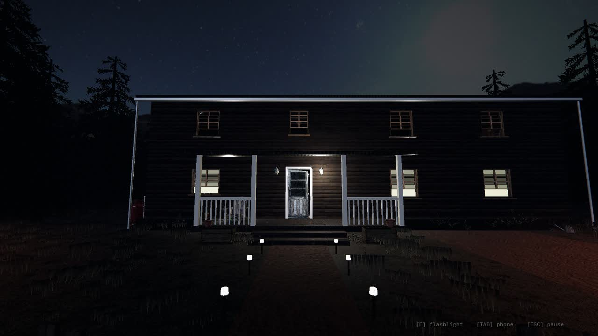
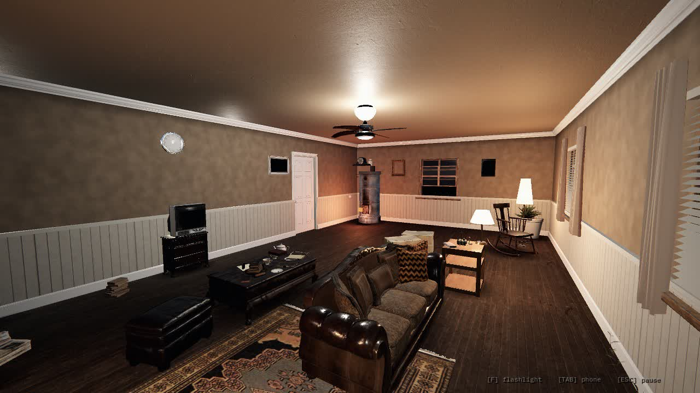
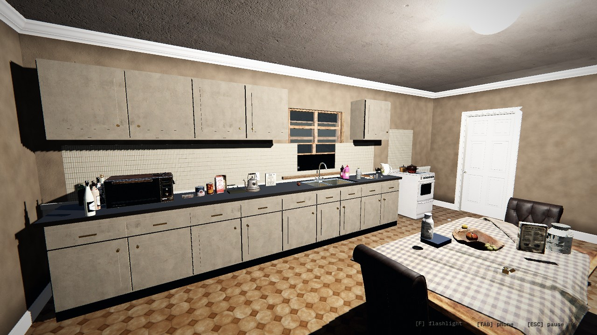

# HOLLOW CREEK ROAD

A first-person psychological horror game made in Godot 4: a two-storey farmhouse, the neighbour's house across the road, a barn, the woods and a long night on Hollow Creek Road.

## ⬇️ Download (Windows)

1. Go to **[Releases](../../releases/latest)** and download **`HollowCreekRoad-Windows.zip`** (about 1.4 GB).
2. Unzip it anywhere (keep `HollowCreekRoad.exe` and `HollowCreekRoad.pck` in the same folder).
3. Run **`HollowCreekRoad.exe`**. If Windows SmartScreen appears, click *More info → Run anyway* (the game isn't code-signed).

Headphones recommended. Runs on old PCs too (tested on a GeForce GT 730, OpenGL); graphics presets in Settings.






October 14, 2003. You and your dad drive out to Grandma's old house on Hollow Creek Road to pack up her things. Dad goes back to town. His car breaks down. You're alone for the night, and the old man across the road warns you: if you see a woman out on the road tonight, don't look at her.

## Play

Run `HollowCreekRoad.exe`. Headphones are strongly recommended.

| Key | Action |
| --- | --- |
| WASD + mouse | move / look |
| Shift | run |
| E / left click | interact, hide / leave a hiding spot, turn pages |
| F | flashlight |
| 2 or G | EMF reader (once you find it) |
| Tab | phone |
| Q | previous page |
| Esc | pause / settings |

## Chapters

1. **Arrival** (8:42 PM): the key under the gnome, the cellar breaker, the neighbour, a letter with no stamp, Dad's call.
2. **The Diary** (10:20 PM): Grandma's things, Grandpa's secret, the woman under the street light, the bathroom mirror, the TV.
3. **The Attic** (12:52 AM): footsteps above the ceiling, the music box, the rocking chair, the first hunt.
4. **The Fourteenth** (1:37 AM): the storm, the phone, the power, the house hunt, the cellar.
5. **Across the Road** (1:58 AM): Ray's empty house, his ghost-hunting kit and EMF reader, the clock, the hunt, the chase.
6. **The Tapes** (2:12 AM): the chest, the fallen tree, Ray's trail cameras in the woods, a hunt among the trees.
7. **The Barn** (2:31 AM): Grandpa's truck under the tarp, the EMF search, the barn hunt.
8. **The Bend** (2:48 AM): the bus stop payphone, the headlights, the final hunt, the white cross.

There are 8 hidden notes to collect. Find all of them for a secret epilogue. **Continue** resumes from the furthest chapter you reached, and any chapter can be started from **Chapters**.

Atmosphere: the storm starts at 1:37 AM, with rain streaks outside, rain drumming on the roof indoors, lightning and thunder, and wet roads. The bathroom mirror is a real reflection, and she can appear in it.

## The ghost

When she **hunts**, the lights flicker, your flashlight dies, and she flickers in and out of view.

- If she can see you, she runs at you. If she loses you, she searches where you were last seen.
- Hide in a wardrobe, behind shelves, or under a tarp. She may come and stand right outside.
- If she catches you, you go back to the last checkpoint.

Between scripted scares she also causes random activity: doors open and slam, lights flicker, things get thrown, you hear footsteps behind you and whispers, the TV turns itself on, and she appears at the end of a hallway.

The **EMF reader** shows how close she is. Five lights means she is right next to you.

## Graphics settings

- **Presets:** Low, Medium, High and Ultra.
- **Individual settings:** render scale, shadow quality (Off / Flashlight / Flashlight + moon / All lights), MSAA, FXAA, bloom, film grain, brightness, field of view, view distance, V-Sync.
- **Vulkan-only effects:** SSAO, SSIL, SDFGI global illumination, volumetric fog, SSR + TAA. These switch on automatically on GPUs that support Vulkan or D3D12. Older GPUs run the OpenGL renderer instead.
- **Difficulty** (Easy / Normal / Hard) changes how fast she hunts and how quickly she homes in on you.
- On first launch the game picks **Low** on OpenGL GPUs (about 45–60 FPS on a GT 730) and **High** on modern GPUs.

## Assets and credits

| What | Source | Licence |
| --- | --- | --- |
| Characters: Clara (Female_Adult_11), Mr. Abernathy (Gardener_Male_01) and their animations | [Microsoft Rocketbox Avatar Library](https://github.com/microsoft/Microsoft-Rocketbox) | MIT |
| About 140 props, furniture, tools and vehicles, 26 scanned PBR materials, and the night sky | [Poly Haven](https://polyhaven.com) | CC0 |
| Fonts: Special Elite / IBM Plex Mono and Caveat | Google Fonts | Apache 2.0 / SIL OFL |
| Engine | [Godot](https://godotengine.org) | MIT |

Made from code:

- Houses, barn, roads and telephone poles: built procedurally.
- Trees: procedural pines.
- Sound effects: synthesised (`tools/sfx.py`).
- Voices: Windows speech synthesis, processed.

## Build

```
Godot_v4.7.2-stable_win64.exe --headless --path . --import
Godot_v4.7.2-stable_win64.exe --headless --path . --export-release "Windows Desktop" ../HollowCreekRoad/HollowCreekRoad.exe
```

### Developer test flags (after `--`)

- `--hunttest`: checks the ghost can reach an unhidden player, and cannot reach a hidden one, in every hunt area.
- `--interacttest`: checks every interactable object can be targeted from a standing position.

- `--autotest --chapter=N`: a bot plays the story from chapter N.
- `--shot=name --state=N --cam=x,y,z,yaw,pitch`: takes a screenshot. Can be combined with `--torch`, `--ghost=x,z,y`, `--ghostanim=walk`, `--scream`, `--emf`, `--hide=id` and `--preset=N`.


## Credits

3D models, textures and sounds: Poly Haven (CC0), Microsoft Rocketbox (MIT), Mixkit (free licence) and Sketchfab artists (CC BY, see [CREDITS_SKETCHFAB.md](CREDITS_SKETCHFAB.md)).
